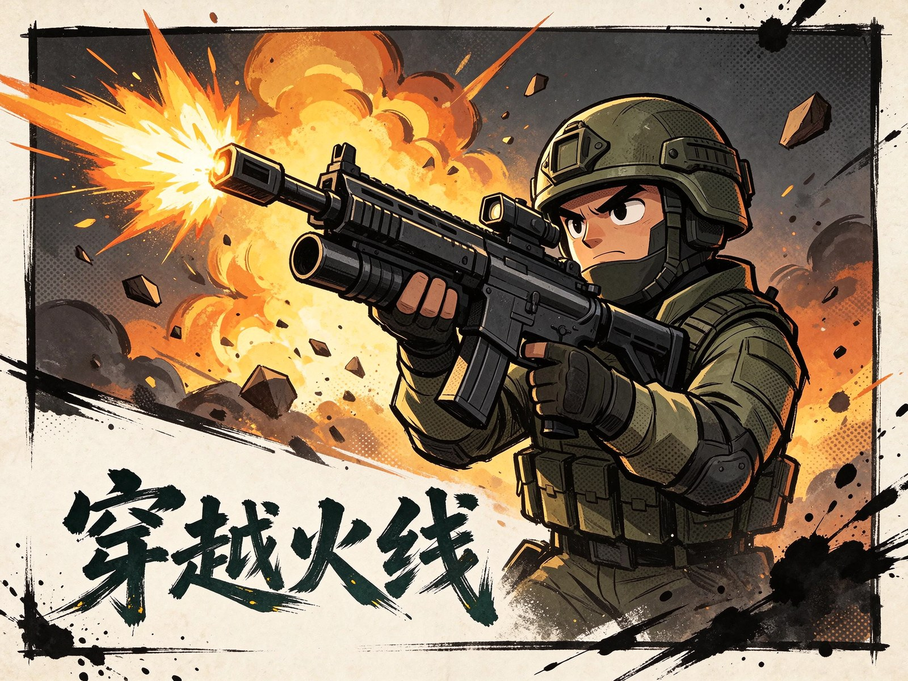

<p align="center"></p>

<h1 align="center">穿越火线 · 网页版 CF</h1>

<p align="center">Three.js 写的浏览器第一人称射击，致敬 CF 玩法，MIT 开源</p>

<p align="center">
  <a href="https://aiyangdie.github.io/cf-game/">在线试玩</a> ·
  <a href="https://github.com/aiyangdie/cf-game/releases/latest">下载发布包</a> ·
  <a href="LICENSE">MIT 许可</a>
</p>

## 简介

源码即网站：推 `main` 自动部署到 GitHub Pages，`npm run build` 产出可自托管的 zip。主菜单会显示版本号与 build 号，和最新 Release 不一致时按 `Ctrl+F5` 强刷。

## 功能

- **波次射击**：掩体、可见飞行子弹、难度曲线（新兵 / 老兵 / 精英）
- **三把武器**：AK、沙鹰、军刀，`1/2/3` 切换
- **军械库成长**：GP 购买与永久升级（火力、弹匣、防弹衣、生命、速度），军衔显示在 HUD
- **程序化音效**：Web Audio 合成枪声、换弹、命中、爆头、脚步，不依赖音频文件
- **可选访问密码门**：适合自建站做简单限访（前端校验，不是服务端安全）
- **版本可追溯**：`CHANGELOG.md` + 版本台账 + 发版脚本

## 操作

| 按键 | 功能 |
|---|---|
| W A S D | 移动 |
| Shift + W | 向前冲刺（须按住 W） |
| Space | 跳跃 |
| 鼠标 / 左键 | 瞄准（点击锁定）/ 射击或挥刀 |
| 1 / 2 / 3 | AK / 沙鹰 / 军刀 |
| R | 换弹 |
| ESC 或 P | 暂停 / 继续 |
| M | 开关音效 |

Shift 卡住时按 ESC 暂停再 P 继续可重置按键状态。

## 快速开始

```bash
git clone https://github.com/aiyangdie/cf-game.git
cd cf-game
npm start          # http://localhost:3000
```

也可以直接用浏览器打开 `index.html`（推荐 Chrome / Edge）。自建站部署：下载 Release 里的 zip 解压到站点根目录，用 Nginx、Apache 或对象存储静态托管。

## 访问密码门（可选）

```bash
cp config.example.js config.js
```

在 `config.js` 里把 `accessGate.enabled` 设为 `true` 并填密码即可。公开演示站默认关闭。

## 项目结构

```
index.html          入口页面
game.js             游戏主逻辑（移动、射击、敌人、道具）
audio.js            程序化音效
gate.js             访问密码门
config.js           站点配置（含版本号）
scripts/build-release.js  Release 打包
docs/ROADMAP.md     路线图
```

## 版本历史

| 版本 | 要点 |
|---|---|
| v1.1.0 | 军械库 GP 升级、武器与角色成长 |
| v1.0.7 | 版本台账、发版脚本与版本文档 |
| v1.0.6 | 可见飞行子弹、敌人分档变强 |
| v1.0.5 | 跳跃、冲刺优化、脚步声 |
| v1.0.4 | 音效、暂停、子弹轨迹 |
| v1.0.0 | 开源首发，三武器与 Pages 部署 |

后续计划（手雷、狙击枪、多地图、多人联机）见 [docs/ROADMAP.md](docs/ROADMAP.md)。

## 免责声明

非腾讯《穿越火线》官方产品，仅供学习与交流。

## 许可证

[MIT](LICENSE)
